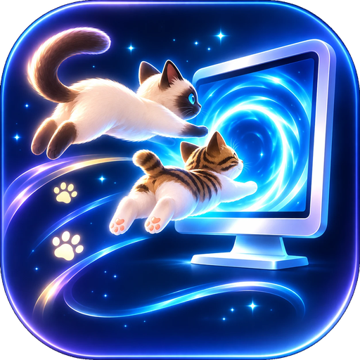

# ツナグ（Tsunagu）

**Windows のリモートデスクトップ（mstsc）を、設定なしで一発でつなぐランチャー。** 無償のフリーウェアです。

同じ LAN／VPN 上の Windows PC を自動で見つけて一覧にし、今つなげるか（可否）を 🟢🟡🔴 で表示、
ボタンひとつでリモート接続します。画面転送は Windows 標準の RDP をそのまま使うので、画質・遅延・互換性は mstsc と同じです。

## ダウンロード

👉 **[最新版（Releases）](../../releases/latest)** から `Tsunagu_Setup_x.x.x.exe` をダウンロードして実行してください。

> 無償のフリーウェアです。現在は未署名のため、初回起動時に Windows SmartScreen の警告が出ることがあります
> （「詳細情報」→「実行」で進めます）。

## できること

- 同じ LAN／VPN の Windows PC を**自動で発見**し、今つなげるかを緑・黄・赤で表示
- **通常接続／画面共有**の2ボタンで一発接続（初回だけ相手 PC で承認、以後は承認不要）
- **システムトレイに常駐**、右クリックから一覧 → 接続。**Windows 起動時の自動起動**にも対応
- IP やパスワードを毎回入れなくてよい（資格情報は Windows / mstsc が記憶）

## 動作環境

- **Windows 10（64bit, build 19045 以上）／Windows 11**
- 接続先 PC で**リモートデスクトップ（RDP）が使えること**（Home 版はホストになれません）
- つなぐ側・受け側が**同じ LAN、または VPN** でつながっていること（インターネット越し＝VPN 無しには非対応）

## 安全について

- 毎回の承認プロンプトは無くしていますが、つなぐには**有効な資格情報が必須**（NLA を常に要求）。
- 受け側の有効化は、その PC の持ち主の承認（UAC）でだけ行います。遠隔から他人の PC を有効化する機能はありません。
- **パスワードはツナグに保存しません**（Windows 資格情報マネージャー／mstsc に任せます）。

## ライセンス

無償のフリーウェア（HitoYuka 提供・**無保証**）。[LICENSE](LICENSE) ／ 同梱する第三者ソフトウェアの表記 [THIRD-PARTY-NOTICES.md](THIRD-PARTY-NOTICES.md)。

---

© 2026 HitoYuka — ツナグ（Tsunagu）
